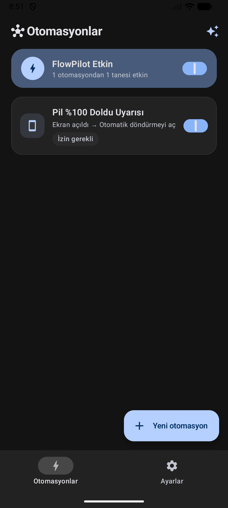
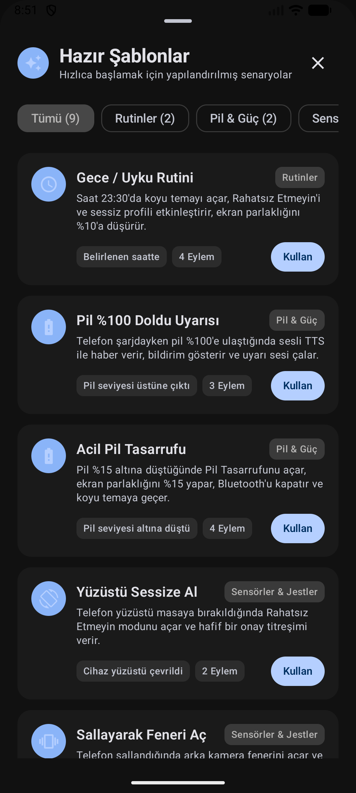
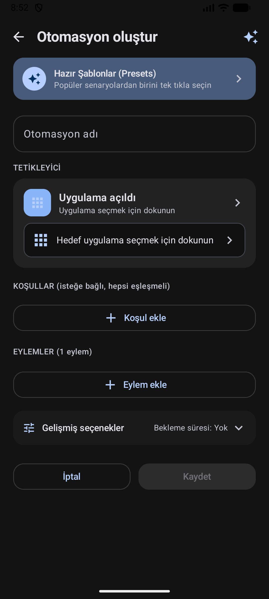
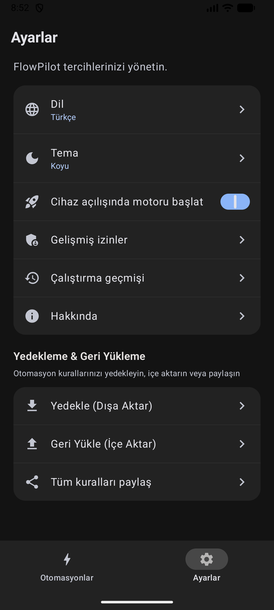
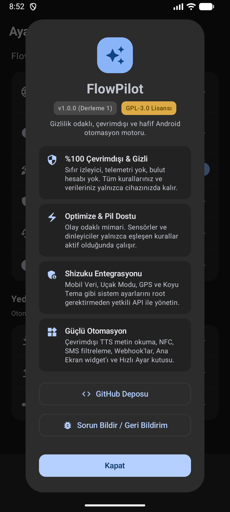

<div align="center">

# ⚡ FlowPilot

### Gizlilik odaklı, pil dostu ve hafif Android otomasyon motoru — rootsuz.

Olay odaklı tetikleyiciler, Shizuku ile ayrıcalıklı sistem yetkileri ve akıcı Material 3 arayüzüyle cihazınızı zahmetsizce otomatikleştirin. Telemetri yok, bulut hesabı zorunluluğu yok ve arka planda gereksiz pil tüketimi yok.

<br/>

[](https://github.com/emi-ran/flowpilot/releases)
[-34A853?logo=android&logoColor=white)](https://developer.android.com)
[](https://kotlinlang.org)
[](https://developer.android.com/jetpack/compose)
[](https://shizuku.rikka.app)
[](#-gizlilik-ve-s%C4%B1f%C4%B1r-g%C3%BCven-ilkesi)
[](LICENSE)

<br/>

[**🇹🇷 Türkçe**](README.tr.md) &nbsp;•&nbsp; [**🇺🇸 English**](README.md)

<br/>

<p align="center">
  <a href="https://github.com/emi-ran/flowpilot/releases/latest">
    
  </a>
  &nbsp;
  <a href="#-nasıl-çalışır">
    
  </a>
  &nbsp;
  <a href="#-1-tıkla-hazır-reçeteler">
    
  </a>
  &nbsp;
  <a href="#-shizuku-kurulum-kılavuzu">
    
  </a>
</p>

</div>

---

> [!NOTE]
> **📱 Cihaz Uyumluluğu & Topluluk Testi Bilgilendirmesi**
> FlowPilot bağımsız bir açık kaynak projesidir ve bizzat geliştiricinin kişisel cihazı olan **Xiaomi HyperOS (Xiaomi 15T Pro)** üzerinde günlük olarak geliştirilip test edilmektedir. Proje genelinde standart Android Jetpack ve sistem API'lerine titizlikle uyulmuş; CI'da JVM birim testleri, Android lint, debug/release derlemeleri ve `scripts/` altındaki SDK'sız sözleşme betikleri çalıştırılmaktadır. Cihaz ve OEM davranışları elle ve topluluk geri bildirimleriyle doğrulanır.
>
> Farklı üretici arayüzleri (Samsung One UI, Google Pixel, Motorola, OxygenOS vb.) arka plan kısıtlamalarını farklı uygulayabildiğinden, test geri bildirimleriniz, cihaz deneyimleriniz ve katkılarınız (Pull Request) memnuniyetle karşılanır!

---

## 🌟 Neden FlowPilot?

Geleneksel Android otomasyon uygulamaları genelde karmaşık arayüzler, sürekli arka plan döngüleriyle pili bitiren servisler veya zorunlu bulut üyelikleriyle gelir. **FlowPilot bu anlayışı değiştirmek için geliştirildi.**

<table>
  <tr>
    <td width="50%">
      <h3>🔋 Pil Dostu &amp; Olay Odaklı</h3>
      <p>İşlemciyi uyanık tutan (wake-lock) gereksiz döngüler yoktur. Donanım sensörleri (ivmeölçer, yakınlık, ışık) ve yayın alıcıları <b>yalnızca aktif bir kural ihtiyaç duyduğunda</b> devreye girer, işi bitince anında kapanır.</p>
    </td>
    <td width="50%">
      <h3>🔒 Varsayılan Olarak Çevrimdışı &amp; Gizli</h3>
      <p>Analitik, telemetri ve uzak hesap yoktur. İsteğe bağlı güncelleme kontrolü yalnızca açıksa GitHub'a sorgu gönderir ve Ayarlar'dan kapatılabilir. Webhook ve SMS eylemleri sadece sizin seçtiğiniz verileri iletir.</p>
    </td>
  </tr>
  <tr>
    <td width="50%">
      <h3>🛡️ Root Gerektirmeyen Süper Güçler</h3>
      <p><b>Shizuku</b> desteği sayesinde Mobil Veri, Uçak Modu, GPS, Koyu Tema ve Uygulama Durdurma gibi yetkili işlemleri cihazınızı rootlamadan, güvenli ADB izinleriyle yönetin.</p>
    </td>
    <td width="50%">
      <h3>🎨 Modern Material 3 &amp; Compose</h3>
      <p>Tamamen yerel <b>Jetpack Compose</b> ile inşa edilmiştir. Akıcı animasyonlar, dinamik Material You renk temaları, dokunsal titreşim geri bildirimleri ve şık, yerel ana ekran widget'ı sunar.</p>
    </td>
  </tr>
  <tr>
    <td width="50%">
      <h3>🔊 Çevrimdışı Metin Okuma (TTS)</h3>
      <p>Bildirim metnini, SMS kodunu, arayan bilgisini, pil seviyesini ve diğer tetikleyici verilerini cihaz içi TTS ile seslendirin. Mesajlar ihtiyaç anında sentezlenir ve çevrimdışı önbelleğe alınır; internet gerekmez.</p>
    </td>
    <td width="50%">
      <h3>🔐 Güvenli Paylaşım &amp; Şifreli Yedek</h3>
      <p>Kurallarınızı temizlenmiş JSON olarak paylaşın veya tüm otomasyon arşivinizi <b>AES-256-GCM parola korumalı</b> (100.000 iterasyon PBKDF2) güvenli yedeklerle koruma altına alın.</p>
    </td>
  </tr>
</table>

---

## 📸 Ekran Görüntüleri

<div align="center">
  <table>
    <tr>
      <td align="center" width="20%"><b>Ana Ekran</b></td>
      <td align="center" width="20%"><b>Hazır Şablonlar</b></td>
      <td align="center" width="20%"><b>Kural Oluşturucu</b></td>
      <td align="center" width="20%"><b>Ayarlar &amp; Yedek</b></td>
      <td align="center" width="20%"><b>Hakkında</b></td>
    </tr>
    <tr>
      <td></td>
      <td></td>
      <td></td>
      <td></td>
      <td></td>
    </tr>
  </table>
</div>

---

## 💡 Nasıl Çalışır?

FlowPilot son derece sezgisel, 3 adımlı bir zihinsel model izler:

```
┌───────────────────────────┐      ┌───────────────────────────┐      ┌───────────────────────────┐
│      1. TETİKLEYİCİ       │      │        2. KOŞULLAR        │      │        3. EYLEMLER        │
│      "Şu olduğunda"       │ ───► │   "Yalnızca hepsi uyuyorsa"│ ───► │     "Sırayla şunları yap" │
│   (Örn: İşe vardığımda)   │      │    (Örn: Yalnızca Hafta İçi)│     │(Sessize al + Wi-Fi'ı aç)  │
└───────────────────────────┘      └───────────────────────────┘      └───────────────────────────┘
```

### Günlük Hayattan Senaryolar:
- 🌙 **Gece Rutini:** Saat 23:30 olduğunda ➔ *Eğer cihaz şarjdaysa* ➔ Sessiz profile geç, Rahatsız Etmeyin'i aç ve parlaklığı %10'a düşür.
- 🔋 **Tam Şarj Uyarısı:** Pil %100 dolduğunda ➔ *Çevrimdışı sesle* "Pil tamamen doldu, lütfen şarjdan çıkarın" anonsu yap ve bildirim göster.
- 🔕 **Ters Çevir ve Sustur:** Telefon masaya yüzüstü konulduğunda ➔ *Hafif bir titreşim onayıyla* Rahatsız Etmeyin modunu aktif et.

---

## ⚡ 1 Tıkla Hazır Reçeteler

Günlük yaşamınızı anında kolaylaştıracak yerleşik şablonlarla hemen başlayın:

| Reçete | Tetikleyici | Başlıca Eylemler |
| :--- | :--- | :--- |
| 🌙 **Gece Rutini** | Saat 23:30 olduğunda | Koyu Temayı açar, Sessiz profile geçer, DND modunu açar, parlaklığı %10 yapar |
| 🔋 **Tam Pil Koruması** | Pil %100'e ulaştığında | Çevrimdışı sesli şarjdan çıkarma uyarısı seslendirir ve bildirim gönderir |
| ⚡ **Acil Pil Tasarrufu** | Pil şarjda değilken %15 altına düştüğünde | Pil Tasarrufunu açar, Bluetooth'u kapatır, parlaklığı %15 yapar, Koyu Temaya geçer |
| ☀️ **Sabah Uyanışı** | Şarjdan çekilince VEYA ekran açılınca (hafta içi 05:00–10:00) | DND'yi kapatır, sesi normale alır, parlaklığı %70 yapar |
| 🌙 **Gece Sessizliği** | 23:00 zamanlaması VEYA ekran kapanınca (22:00–08:00) | DND'yi açar, ses profilini sessize alır, medya sesini %20'ye indirir |
| 🚗 **Sabah Yola Çıkış** | Ev Wi-Fi'si kaybolunca VEYA şarjdan çekilince (06:00–10:00) | Mobil Veriyi açar, sesi normale alır, medya sesini %80 yapar |
| 🎯 **Odak / Çalışma Modu** | Hafta içi 09:00, ev Wi-Fi'sinde değilken | DND'yi açar ve sesi titreşime alır |
| 🌃 **Gece Ekran Kısma** | 00:00–06:00 arası ekran açılınca ve pil %60 altındaysa | Parlaklığı %10'a düşürür, Koyu Temayı açar |
| 🔕 **Ters Çevir ve Sustur** | Telefon yüzüstü konulduğunda | Çift sensör doğrulamasıyla (Yakınlık + Yerçekimi Z-ekseni) DND modunu titreşimle açar |
| 🔦 **Sallayarak Fener Aç/Kapat** | Cihaz sağlam sallandığında | Kamera flaşını dokunsal geri bildirimle açar veya kapatır |
| 🎬 **Sinema / Gece Okuma** | Ortam ışığı < 5 lüks olduğunda | Parlaklığı minimuma indirir ve sistemi Koyu Temaya geçirir |
| 🚗 **Evden Çıkış Modu** | Ev Wi-Fi bağlantısı koptuğunda | Mobil Veriyi açar (Shizuku), Normal zil sesine geçer, medya sesini %80 yapar |
| 🏠 **Eve Giriş Modu** | Ev Wi-Fi ağına bağlanıldığında | Pil tasarrufu için Mobil Veriyi kapatır (Shizuku) ve dengeli ses ayarlarını geri yükler |
| 📍 **SMS Acil Konum Yanıtlayıcı**| Gizli kelimeli SMS geldiğinde | GPS koordinatlarını alıp harita bağlantısını SMS ile otomatik yanıtlar |

---

## 🎛️ Kabiliyetler Matrisi

### 1. Tetikleyiciler (Olaylar)
FlowPilot zengin bir donanım, radyo ve sistem olayı yelpazesini dinler:

Bir kural en fazla beş bağımsız tetikleyiciyi VEYA mantığıyla birleştirebilir (örneğin Uygulama açıldı VEYA Wi-Fi bağlandı). Oluştur/Düzenle ekranında tetikleyici ekleyebilir, kaldırabilir ve sıralayabilirsiniz. Tüm kaynaklar ortak kural bekleme süresini ve aynı sıralı eylemleri kullanır; geçmiş eşleşen kaynağı gösterir. Eski tek tetikleyicili kurallar ve JSON biçimi korunur.

- 📱 **Uygulama Döngüsü:** Seçilen uygulamanın açılması veya kapanması (düşük maliyetli `UsageStatsManager` geçişleri).
- 🔌 **Güç & Pil:** Şarja takılma / çıkarılma, pil seviyesinin belirlenen yüzdenin üstüne çıkması veya altına inmesi.
- 💡 **Ekran & Durum:** Ekranın açılması / kapanması, kilit ekranının açılması.
- ⏰ **Zaman & Takvim:** Günlük, hafta içi, hafta sonu veya özel seçili gün ve saatlerde zamanlanmış tetikleme.
- 📶 **Bağlantılar:** Wi-Fi ağına bağlanma / ayrılma (tüm ağlar veya belirli SSID), Bluetooth cihazına bağlanma / ayrılma.
- 🔄 **Sensörler & Hareket:**
  - **Cihazı Çevirme:** Yüzüstü masaya konma veya tekrar çevrilme (Yakınlık + Yerçekimi Z-ekseni, 500ms kararlılık filtresi).
  - **Sallama:** Tetik ayarlarındaki kural bazlı güç kaydırıcısı (6–32 m/s²); tek sallama tek tetik üretir.
  - **Ortam Işığı:** Lüks değerinin belirlenen sınırın altına düşmesi veya üstüne çıkması.
- 📍 **Donanım Coğrafi Çit (Geofence):** Google Play Services `GeofencingClient` ile belirlenen alana giriş/çıkış. Boşta CPU wake-lock kullanmaz; yeniden başlatmada kaybolmayan 50 olaylık kalıcı kuyruk kullanır. Güncel geçiş koordinatları konum şablonlarında kullanılır; eski koordinatlar yerine yeni konum alınır veya değerler boş bırakılır.
- 🏷️ **NFC Etiketleri:** Fiziksel taramalarda anında hex UID eşleşmesi. Ön plandaki ReaderMode taramaları eşleşen kuralları otomatik çalıştırır; Android arka plan keşfi FlowPilot'ı açar ve eşleşen NFC otomasyonu çalışmadan önce açık onay ister.
- 📞 **Arama & SMS:** Gelen arama çalıyor, yanıtlandı, giden arama başladı, arama bitti; SMS gönderen numaraya ve kelime, önek veya regex kalıbına göre tetikleme.
- 🔔 **Bildirimler:** Seçili uygulamalardan gelen bildirimler ve anahtar kelime filtreleme. FlowPilot'un kendi durum bildirimleri ve HyperOS ses/kulaklık arayüz bildirimleri yok sayılır; yerinde güncelleme veya OEM süreç sonlandırması sonrası Android dinleyiciyi bağsız bırakırsa bildirim kuralları sistemden yeniden bağlanma ister.
- 🎵 **Medya:** Oynatma başladığında, duraklatıldığında veya parça değiştiğinde tetikler; isteğe bağlı medya uygulaması filtresi vardır. Bildirim erişimi gerekir; dinleme yalnızca etkin kurallar ihtiyaç duyduğunda yapılır. Takipçi başladığında zaten mevcut oturumlar olay üretilmeden sessizce başlangıç durumuna alınır; başlangıçtan sonra yeni görülen ve zaten oynayan bir oturum ise oynatma olayı üretir. `${media.title}` ve `${media.artist}` geçici olay değerleridir; günlük veya çalışma geçmişine yazılmaz. Şablon destekli eylemler bu değerleri açıkça gösterebilir veya gönderebilir.

---

### 2. Koşullar (Mantıksal Filtreler)
Kurallar yalnızca koşulları sağlandığında çalışır. Koşulları VE veya VEYA ile birleştir, grupları iç içe kur ve herhangi bir grubu DEĞİL (NOT) ile tersine çevir:

- ⏳ **Zaman Aralığı:** Yalnızca belirlenen saatler arasında çalış (örn: 23:00 - 07:00, gece yarısını geçen aralıklar tam desteklenir).
- 📅 **Haftanın Günleri:** Hafta içi, hafta sonu veya özel seçili günler.
- 🔋 **Pil Seviyesi:** Pilin belirli bir yüzdenin $\ge$ veya $\le$ olması.
- ⚡ **Şarj Durumu:** Cihazın şarjda veya pilde olması koşulu.
- 📲 **Ekran Durumu:** Ekranın açık veya kilitli olması koşulu.
- 📶 **Wi-Fi Ağı:** Yalnızca belirli bir Wi-Fi ağına (SSID) bağlıyken çalış.
- 🧩 **İç İçe Mantık:** Koşulları grup başına VE/VEYA ile birleştir, bir grubu tersine çevir ve dört seviyeye kadar iç içe kur.

---

### 3. Eylemler (İşlemler)
Tek bir kuralda birden çok eylemi sürükle-bırak yöntemiyle dilediğiniz sırada çalıştırın ve eylemler arasına gecikme (0–300 sn) ekleyin:

- 🌐 **Bağlantı Kontrolü (Shizuku ile):** Wi-Fi, Mobil Veri, Uçak Modu, Bluetooth, GPS Konum ve Wi-Fi Erişim Noktası (Android 16+) açma/kapatma.
- 🖥️ **Ekran & Sistem:** El Feneri açma/kapatma, Koyu Tema (Shizuku), Ekranı Otomatik Döndürme, Parlaklık seviyesi, Ekranı Kilitleme (Shizuku), Uygulamayı Zorla Durdurma (Shizuku).
- 🔊 **Ses & Uyarılar:** Rahatsız Etmeyin (DND) açma/kapatma, Ses Profilleri (Normal / Titreşim / Sessiz), Medya Sesi (%0–100), Özel Ses Çalma (1–60 sn), Titreşim Şablonları (Tek darbe, Çift dokunuş, Uyarı, Kalp atışı, Üçlü dokunuş, SOS) ve Bildirim Gösterme.
- 🎵 **Medya Kontrolleri:** Oynat, duraklat, oynat/duraklat, sonraki veya önceki parça; isteğe bağlı olarak belirli bir medya uygulaması hedeflenebilir. Medya oturumlarına erişim için bildirim erişimi gerekir; kullanılabilirlik oynatıcıya bağlıdır.
- 🎵 **Şarkı ara veya aç:** Spotify ya da YouTube Music'te şarkı adına göre arayın veya desteklenen şarkı bağlantısını seçili uygulamada açın. Her iki alanda `${notification.text}` gibi tetikleyici değişkenleri kullanılabilir; çözümlenen bağlantı seçilen servise uygun olmalıdır. Otomatik oynatma garanti değildir; davranış oynatıcıya, hesaba ve Android arka plan kısıtlarına bağlıdır.
- 🗣️ **Çevrimdışı Seslendirme (TTS):** Cihazın yerleşik TTS motoruyla metinleri sesli olarak okuyun (konuşma hızı ayarlı). Ses seçicide **Sistem varsayılanı** (telefonun çevrimdışı TTS sesi veya en iyi çevrimdışı yedek) bulunur ve örnek metin seçili sesin dilinde önizlenir. Şablonlarda `${notification.text|stripPrefix:"tts"|trim}`, `${sms.otp}`, `${call.state}` ve `${batteryPercent}` gibi tetikleyici verileri kullanılabilir; ses ihtiyaç anında sentezlenir ve önbelleğe alınır.
- ⏱️ **Saat & Sayaç:** Sistem alarmı kurma veya arka planda sessiz zamanlayıcı başlatma (1 sn – 24 saat).
- 🚀 **Uygulama & Web:** Cihazdaki bir uygulamayı açma veya web bağlantısına yönlendirme.
- 💬 **Telefon & SMS:** Arama ekranını açma, doğrudan telefon araması başlatma, doğrudan arka planda SMS gönderme veya SMS taslağı hazırlama.
- 🔗 **HTTPS Webhook:** Canlı şablon değişkenleriyle dış sunuculara güvenli HTTP istekleri (`GET`, `POST`, `PUT`, `PATCH`, `DELETE`, `HEAD`) gönderin; başlıklar ve anahtarlar AES-256-GCM Keystore ile cihazda şifrelenir.
- 🧩 **Şablon Değişkenleri:** Seslendirme, bildirim, webhook, SMS, telefon, URL, alarm ve zamanlayıcı metinlerinde `${...}` kullanın. Şablon destekleyen her eylem alanı, kuralın tetikleyicilerine göre filtrelenmiş aynı aranabilir seçiciyi ve `trim`, `stripPrefix`, `drop`, `truncate`, `lower`, `upper`, `default`, `urlencode`, `jsonescape` filtrelerini sunar. Global değerler: `${trigger}`, `${trigger.index}`, `${batteryPercent}`, `${isCharging}`, `${wifiSsid}`, `${time}`, `${timestamp}` ve `${rule.name}`.

---

### 4. Akıllı Verimlilik & Kolaylıklar
- **Hızlı Ayarlar Kutusu ve Motor Bildirimi:** Otomasyon motorunu bildirim çubuğundan tek dokunuşla açıp kapatabilme veya canlı durumunu görme. Motor durumu ve başlatma hatası bildirimleri, arka plan yeniden başlatmalarından sonra da FlowPilot'ın İngilizce, Türkçe veya sistem dili ayarını izler.
- **Material 3 Ana Ekran Widget'ı:** Aktif kural sayısını gösteren ve tek dokunuşla motoru duraklatıp sürdüren yerel `AppWidgetProvider` (RemoteViews) widget'ı.
- **Canlı Eylem Testi:** Bir kuralı kaydetmeden önce oluşturduğunuz eylemleri doğrudan cihazınızda test edebilme.
- **Kurala Özel Ana Ekran Kısayolu:** Düzenle → Gelişmiş bölümünden başlatıcıya kısayol sabitleyin. Dokunulduğunda kural yeniden yüklenir ve çalıştırmadan önce onay ister; devre dışı veya silinmiş kurallar çalışmaz, sessiz çalıştırma yoktur. HyperOS'ta bu izin verilmemişse FlowPilot Ana ekran kısayolları izin sayfasını açar.
- **Güvenli Kural Çoğaltma:** Mevcut bir kuralı tek tıkla çoğaltma; webhook şifreleri hedef kopya için Keystore ile yeniden şifrelenir.
- **Çalışma Geçmişi:** Son 100 kural tetiklenmesini, eylem bazında sonuçları ve maskelenmiş güvenli detaylarıyla yerel günlükte saklama. Ham sağlayıcı hataları, özel URI'ler, yerel dosya yolları, kimlik bilgileri ve telefon numaraları kalıcı olarak saklanmaz.
- **Çakışma Uyarıları:** Birbirine zıt durum eylemleri içeren kurallarda otomatik, engelleyici olmayan akıllı uyarı sistemi.
- **İlk Açılış Turu:** Altı adımlı spotlight turu (karşılama, şablonlar, oluştur, motor durumu, ayarlar, bitiş) ilk açılışta ilgili alanları vurgular; kural listeniz doluysa oluşturma adımı atlanır. Turu dilediğiniz an atlayabilirsiniz; tamamlandığı cihazda hatırlanır ve Ayarlar → Turu yeniden başlat ile tekrar açılır.

---

## 🛡️ Shizuku Kurulum Kılavuzu

FlowPilot, yetkili işlemleri (Mobil Veri, Uçak Modu, GPS, Koyu Tema, Uygulama Kapatma) root gerektirmeden güvenle yürütebilmek için **Shizuku** köprüsünü kullanır.

1. **Shizuku'yu Yükleyin:** [Google Play](https://play.google.com/store/apps/details?id=moe.shizuku.privileged.api) veya [GitHub](https://shizuku.rikka.app/) üzerinden indirin.
2. **Shizuku Servisini Başlatın:**
   - **Android 11 ve üzeri (Kablosuz Hata Ayıklama):** Bilgisayara gerek kalmadan Geliştirici Seçenekleri > Kablosuz Hata Ayıklama üzerinden doğrudan telefonda başlatın.
   - **Bilgisayardan (ADB ile):** Şu komutu çalıştırın:
     ```bash
     adb shell sh /sdcard/Android/data/moe.shizuku.privileged.api/start.sh
     ```
3. **FlowPilot'a İzin Verin:** FlowPilot'ı açın ve ekranda beliren Shizuku yetkilendirmesini onaylayın.
4. Tüm yetkili işlemler hemen aktif hale gelecek ve sorunsuz çalışacaktır!

---

## 🔒 Gizlilik ve Sıfır-Güven İlkesi

FlowPilot kullanıcı gizliliğine tavizsiz bir bağlılıkla tasarlanmıştır:

- 🚫 **Sıfır Telemetri:** Firebase Analytics, Sentry, uzaktan çökme raporlayıcıları veya takip SDK'ları yer almaz.
- 🔄 **İsteğe Bağlı Güncelleme Kontrolü:** Açıksa FlowPilot herkese açık GitHub Releases API'sini günde en fazla bir kez okur; hesap veya cihaz kimliği göndermez. Ayarlar'dan kapatabilir, manuel kontrolü kullanabilirsiniz.
- 📵 **Bulut Eşitlemesi Yok:** Kurallarınız, günlükleriniz ve anahtarlarınız asla üçüncü taraf bir buluta gönderilmez.
- 🛡️ **Android Keystore Koruması:** Webhook şifreleri ve özel başlıklar AES-256-GCM ile Android Keystore içinde, cihaz desteklediğinde donanım destekli olarak korunur.
- 🙈 **Kişisel Veri Maskeleme:** Telefon numaraları, webhook anahtarları ve gizli başlıklar arayüzde ve loglarda maskelenmiş olarak tutulur.

### Şeffaf İzin Açıklamaları
FlowPilot hassas izinleri yalnızca açık otomasyon özelliklerini yerine getirebilmek için talep eder:
- `QUERY_ALL_PACKAGES`: Android 11+ sürümlerinde Uygulama Tetikleyici ve Uygulama Açıcı listelerini gösterebilmek için gereklidir.
- **Bildirim erişimi:** Bildirim tetikleyicileri ile medya oturumu tetikleyicileri ve kontrolleri için gereklidir; Android bildirim erişimi ayarlarında FlowPilot'a izin verin.
- `RECEIVE_SMS` & `SEND_SMS`: Yalnızca SMS tetikleyicisi ve doğrudan SMS gönderme eylemlerinde kullanılır.
- `ACCESS_BACKGROUND_LOCATION`: Sıfır pil tüketimli donanım geofence takibi (`GeofencingClient`) ve kullanıcının kurguladığı konum şablonları için kullanılır.
- `FOREGROUND_SERVICE_LOCATION`: Android 14+ sürümlerinde geofence ve aktif konum görevlerinin arka planda sorunsuz sürmesi için gereklidir.
- `REQUEST_INSTALL_PACKAGES`: Yalnızca kullanıcı "İndir ve yükle"ye dokunduktan sonra resmi FlowPilot GitHub sürümünden indirilen APK için Android yükleyicisini açar. FlowPilot gözetimsiz indirme veya kurulum yapmaz.

*Not: FlowPilot, bu temel otomasyon izinlerinden feragat etmemek adına Google Play Store dağıtımı hedeflemez. Doğrulanmış APK'ları doğrudan GitHub Releases üzerinden edinebilirsiniz.*

---

## 🔐 Sürüm APK'sını Doğrulama

GitHub Actions tarafından derlenen sürümler, imzalı APK için derleme kaynak kanıtı (build provenance) yayımlar. İndirdiğiniz dosyayı bu depoya karşı doğrulayın:

```bash
gh attestation verify FlowPilot-vX.Y.Z.apk --repo emi-ran/flowpilot
apksigner verify --print-certs FlowPilot-vX.Y.Z.apk
sha256sum FlowPilot-vX.Y.Z.apk
```

- `gh attestation verify` (GitHub CLI 2.49+) APK özetinin bu deponun release iş akışı tarafından kanıtlandığını doğrular ve kaynak commit'i yazdırır. Kanıt adımı eklenmeden önce yayımlanan sürümlerde kanıt bulunmaz.
- `apksigner verify --print-certs` çıktısında `Signer #1 certificate SHA-256 digest: f1e45d3a669954ddfb858d5d3a964a2fa7ba3d00bcb0e65b5ced1ca6d5a79f2b` görünmelidir.
- `sha256sum` sonucu yayımlanan `.sha256` dosyası ve sürüm notlarındaki özetle eşleşmelidir.

Herhangi bir kontrol başarısız olursa APK'yı yüklemeyin. Gradle bağımlılık sağlama toplamları, depo filtreleri ve tüm doğrulama adımları [`docs/SUPPLY_CHAIN.md`](docs/SUPPLY_CHAIN.md) dosyasında belgelenmiştir.

---

## 📦 Yedekleme ve Kurtarma

| Mod | Biçim | Güvenlik | Ne Zaman Kullanılır? |
| :--- | :--- | :--- | :--- |
| **Temizlenmiş JSON** | Düz Metin JSON | Webhook URL ve hassas kimlik bilgileri çıkarılır | Kuralları arkadaşlarınızla veya toplulukla güvenle paylaşırken |
| **Şifreli Tam Yedek** | Şifreli Paket | **AES-256-GCM + PBKDF2** (100.000 iterasyon, salt + IV) | Tüm webhook sırları, telefon numaraları ve aktiflik durumlarıyla eksiksiz yedek |

Geri yükleme çok kolaydır: Dosyanızı seçin, parolanızı girin ve **Birleştir** veya **Üzerine Yaz** tercihinizi yapın. İçe aktarılan sırlar hedef cihazın yerel Android Keystore'u ile anında yeniden şifrelenir.

Normal JSON ile içe aktarılan kurallar devre dışı bırakılır; şifreli geri yüklemede etkinlik durumları korunur. TTS ses dosyaları yedeğe dahil edilmez. Ses şablonları taşınabilir ve ilk oynatmada sentezlenir; metni olmayan eski kurallar için içe aktarma sonrası yeni bir mesaj gerekir.

---

## 🛠️ Mimari ve Teknolojiler

FlowPilot modern Android mimari prensiplerine sadık kalır:

```
FlowPilot
├── app/src/main/java/com/flowpilot/app/
│   ├── actions/          # Eylem yürütücüleri: Shizuku, Ses, TTS, Webhook, SMS, Sistem
│   ├── analysis/         # Çakışma analizi (AutomationConflictAnalyzer) ve kontroller
│   ├── data/             # Veri modelleri, JSON serileştirme, DataStore depoları, Yedekleme
│   ├── engine/           # Ön plan AutomationService, Alıcılar, Sensör takipçileri
│   ├── permission/       # Yetki ve kurulum durumu kontrolleri
│   ├── quicksettings/    # Hızlı Ayarlar Servisi (TileService)
│   ├── shortcut/         # Kurala özel ana ekran kısayolları
│   ├── ui/               # Jetpack Compose Arayüzü (Material 3 Tema, Ekranlar, Bileşenler, Tanıtım Turu)
│   ├── update/           # Uygulama içi güncelleme kontrolü, indirme ve kurulum akışı
│   └── widget/           # Ana ekran widget'ı (AppWidgetProvider + RemoteViews)
└── app/src/test/         # Deterministik JUnit birim testleri
```

- **Dil:** Kotlin 2.2.10
- **Arayüz:** Jetpack Compose & Material 3
- **Eşzamanlılık:** Kotlin Coroutines & StateFlow
- **Depolama:** Jetpack DataStore (Preferences & JSON)
- **Şifreleme:** Android Keystore (AES-256-GCM)
- **Sistem Köprüsü:** Shizuku AIDL IPC
- **Widget:** Yerel AppWidget (`AppWidgetProvider` + `RemoteViews`)
- **Hedef SDK:** Android 16 (API 36) &bull; **Minimum SDK:** Android 8.0 (API 26)

---

## 📥 Kaynak Koddan Derleme

### Gereksinimler
- JDK 17 (OpenJDK veya Eclipse Temurin)
- Android SDK (Platform 36, Build-Tools 36.0.0+)
- Python 3 (SDK'sız sözleşme kontrolleri için)
- Git

```bash
# Depoyu klonlayın
git clone https://github.com/emi-ran/flowpilot.git
cd flowpilot

# Birim testlerini çalıştırın
./gradlew testDebugUnitTest

# SDK'sız sözleşme kontrollerinin tamamını çalıştırın
for script in scripts/*.py; do python "$script" || exit 1; done

# Hata ayıklama (Debug) APK'sını oluşturun
./gradlew assembleDebug
```

Derlenen APK çıktısı:
```text
app/build/outputs/apk/debug/app-debug.apk
```

Cihazınıza doğrudan ADB ile yükleyin:
```bash
adb install -r app/build/outputs/apk/debug/app-debug.apk
```

Debug derlemeleri **FlowPilot Dev** adıyla ve `com.flowpilot.app.debug` uygulama kimliğiyle kurulur; release uygulaması `com.flowpilot.app` olarak kalır, böylece ikisi yan yana durabilir. Shizuku, bildirim erişimi ve diğer ayrıcalıklı izinleri debug uygulamasına ayrıca verin. Debug derlemeleri release güncelleme kontrollerini atlar.

---

## 🤝 Katkıda Bulunma

Hata bildirimleri, öneriler ve kod katkıları memnuniyetle karşılanır!
- Başlamadan önce [CONTRIBUTING.md](CONTRIBUTING.md) dosyasını inceleyebilirsiniz.
- Bir sorunla karşılaştıysanız [Hata Bildirimi](https://github.com/emi-ran/flowpilot/issues/new?template=bug_report.md) oluşturabilirsiniz.
- Yeni bir tetikleyici veya eylem öneriniz varsa [Özellik İsteği](https://github.com/emi-ran/flowpilot/issues/new?template=feature_request.md) şablonunu kullanabilirsiniz.

---

## 📄 Lisans

FlowPilot, **[GNU General Public License v3.0 (GPL-3.0)](LICENSE)** kapsamında lisanslanmış özgür ve açık kaynaklı bir yazılımdır.

<div align="center">
  <br/>
  <b>Android Güç Kullanıcıları için ❤️ ile Geliştirildi</b>
</div>
